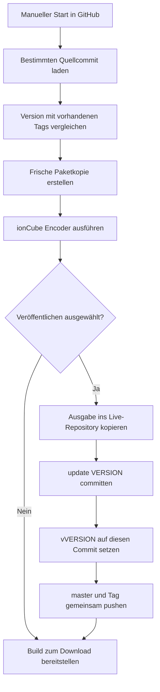

# Webmodul mit Windows VM und GitHub Actions veröffentlichen

Diese Anleitung richtet einen zentralen Build für das Webmodul ein. Berechtigte Entwickler starten ihn in GitHub; eine Windows-VM prüft die Version, führt ionCube aus und veröffentlicht auf Wunsch Commit und Tag im Live-Repository.

Die Einrichtung verwendet eure vorhandenen Repositorys und die Einstellungen aus `03_webmodul_verschluesseln.bat`. Der normale Start ist zunächst ein **Testbuild ohne Commit, Tag oder Push**. Eine Veröffentlichung wird beim Start ausdrücklich ausgewählt.

Stand: 27.10.2026. Die Workflow-Datei ist auf gültige YAML-Syntax geprüft. Der PowerShell-Ablauf wurde mit temporären Git-Repositorys und einem simulierten Encoder geprüft: Testbuild, Paketausschlüsse, Commit-Nachricht, Tag, gemeinsamer Push und Abbruch bei Encoder-Fehlern. Die Aktivierung des Runners, die Serverlizenz und der erste echte Encoder-Lauf müssen auf eurem Server erfolgen.

## Überblick

| Bestandteil | Verwendung |
| --- | --- |
| `xsigns/october-webmodul` | Quellcode, Workflow und Build-Skripte |
| `xsigns/october-webmodul-live` | Verschlüsselte Veröffentlichung auf `master` |
| Windows-VM | Dauerhaft installierter und lizenzierter ionCube Encoder |
| GitHub Actions Runner | Windows-Dienst, der die Aufträge aus GitHub ausführt |
| GitHub App | Technischer Zugang zum Live-Repository, unabhängig von einem Mitarbeiterkonto |
| Environment `webmodul-release` | Einstellungen und geschützte Schlüssel für den Build |



Die Veröffentlichung endet beim Git-Push. Eine Installation auf Kundenservern gehört nicht zu diesem Workflow.

## 1. Voraussetzungen prüfen

Du benötigst Administratorzugriff auf die VM und ausreichende Rechte in GitHub, um Runner, eine GitHub App und Repository-Einstellungen anzulegen. Die Kollegen, die später starten sollen, brauchen Schreibzugriff auf das Quellrepository.

Diese Anleitung setzt ein privates Quellrepository voraus. Der Runner ist für vertrauenswürdige Build-Aufträge vorgesehen; der Workflow wird nur manuell vom Standardbranch gestartet, nicht durch Pull Requests. [Runner-Voraussetzungen](https://docs.github.com/en/actions/how-tos/manage-runners/self-hosted-runners/add-runners)

Prüfe in GitHub den Namen des **Standardbranches von `october-webmodul`**. Das kann `master` oder ein anderer Name sein. Die Vorlage ermittelt ihn automatisch. Der Zielbranch im **Live-Repository** ist dagegen fest `master`.

Für das Environment in einem privaten Organisationsrepository wird ein geeigneter GitHub-Tarif benötigt, beispielsweise GitHub Team. Zusätzliche Freigaben durch Reviewer sind bei privaten Repositorys tarifabhängig; die Anleitung setzt sie nicht voraus. Wenn Environments im vorhandenen Tarif fehlen, muss entweder der Tarif angepasst oder die Vorlage bewusst auf Repository-Secrets ohne Environment umgestellt werden. [Verfügbarkeit von Environments](https://docs.github.com/en/actions/how-tos/deploy/configure-and-manage-deployments/manage-environments)

## 2. Windows VM vorbereiten

1. Eine feste Windows-VM bereitstellen, beispielsweise Windows Server 2022 x64.
2. Als anfängliche Dimensionierung etwa 2 virtuelle CPUs, 4 GB RAM und ausreichend Platz für Windows, Encoder und mehrere Build-Arbeitsverzeichnisse einplanen. Das ist ein Startwert, keine gemessene Mindestanforderung für euren Build.
3. Windows aktualisieren und ein eigenes Dienstkonto, beispielsweise `svc_webmodul`, für den Runner vorsehen.
4. Git for Windows und PowerShell 7 für alle Benutzer installieren.
5. Ausgehende HTTPS-Verbindungen zu GitHub, den GitHub-Actions-Diensten und den für die Encoder-Aktivierung erforderlichen ionCube-Diensten ermöglichen. Ein öffentlich erreichbarer Webserver auf der VM ist für den Runner nicht erforderlich.
6. Für Verwaltung RDP über euren üblichen geschützten Verwaltungszugang verwenden.

In einer neuen PowerShell prüfen:

```powershell
git --version
pwsh --version
```

Der Runner-Dienst muss dieselben Programme über seinen `PATH` finden. Nach Installationen gegebenenfalls den Dienst neu starten.

## 3. ionCube installieren und lizenzieren

1. Den passenden Windows-Encoder auf der VM installieren. Für den ersten vergleichbaren Build dieselbe Version wie lokal verwenden: **ionCube Pro PHP Encoder 14.0.2**.
2. Die Lizenz für diese VM aktivieren. Nicht einfach die lokalen Lizenzdateien kopieren: ionCube-Lizenzen sind maschinengebunden. Vorher klären, ob eine zusätzliche Lizenz benötigt wird oder die lokale Lizenz übertragen werden soll. [ionCube-Lizenzierung](https://www.ioncube.com/guides/encoder-licensing.php)
3. Den tatsächlichen Installationsordner notieren, beispielsweise `C:\Program Files (x86)\ionCube Pro PHP Encoder 14.0.2`.
4. Prüfen, dass `ioncube_encoder74.exe`, `ioncube_encoder81.exe` und `ioncube_encoder82.exe` vorhanden sind. Genau diese drei Programme verwendet euer aktueller Export.
5. Sicherstellen, dass der spätere Runner-Dienstbenutzer den Encoder starten und seine benötigten Lizenzdaten verwenden kann. Der erste Testbuild in Schritt 10 überprüft das im tatsächlichen Dienstkontext.

Die Programmaktivierung ist unabhängig von den Parametern `--passphrase`, `--obfuscation-key` und `--with-license fewo.lic`. Die bestehenden Werte und Lizenzoptionen des Webmoduls beibehalten, damit der Serverbuild zu eurem vorhandenen Lizenzverfahren passt.

Für diese Anleitung bleibt die VM dauerhaft bestehen. Für kurzlebige Container oder wechselnde Cloud-Runner wäre zusätzlich das Lizenzmodell der [ionCube CI Edition](https://blog.ioncube.com/2025/04/30/best-practices-for-using-ioncube-encoder-in-ci-cd-pipelines/) zu bewerten.

## 4. Runner mit GitHub verbinden

1. In GitHub `xsigns/october-webmodul` öffnen.
2. **Settings > Actions > Runners > New self-hosted runner** auswählen.
3. **Windows** und **x64** wählen.
4. Auf der VM eine PowerShell als Administrator öffnen und `C:\actions-runner` anlegen.
5. Die aktuell von GitHub angezeigten Download-, Prüf- und Entpackbefehle in diesem Ordner ausführen. Keine alte Runner-Downloadadresse übernehmen.
6. Den dort angezeigten `config.cmd`-Befehl mit der Repository-URL und dem kurzlebigen Registrierungstoken ausführen.
7. Als Runner-Namen beispielsweise `webmodul-build-01` verwenden. Das zusätzliche Label **`ioncube`** eintragen; die Standardlabels `self-hosted`, `Windows` und `X64` beibehalten.
8. Die Frage nach der Installation als Dienst mit **Ja** beantworten und das vorgesehene Dienstkonto auswählen. Arbeitsverzeichnis `_work` kann bleiben.
9. Dem Dienstkonto Änderungsrechte im Runner-Verzeichnis geben und die beim Dienstsetup erforderliche Berechtigung zum Anmelden als Dienst sicherstellen. Ein dauerhaftes Administratorkonto ist für die Build-Aufträge nicht vorgesehen.
10. Unter **Settings > Actions > Runners** prüfen, dass der Runner **Idle** beziehungsweise online angezeigt wird.

Dienststatus auf der VM:

```powershell
Get-Service 'actions.runner.*'
```

Nach einem Neustart der VM soll der Runner ohne Benutzeranmeldung wieder online sein. Der Registrierungstoken ist nur für die Einrichtung bestimmt und gehört nicht in die Workflow-Secrets. [Runner hinzufügen](https://docs.github.com/en/actions/how-tos/manage-runners/self-hosted-runners/add-runners)

## 5. GitHub App für das Live-Repository anlegen

Der Standardtoken eines Workflows im Quellrepository reicht für den Zugriff auf ein anderes privates Repository nicht aus. Dafür verwendet die Vorlage eine eigene GitHub App.

1. In den Einstellungen des Kontos beziehungsweise der Organisation `xsigns` **Developer settings > GitHub Apps > New GitHub App** öffnen.
2. Einen verfügbaren Namen wählen, beispielsweise `xsigns-webmodul-release`.
3. Als Homepage die URL des Quellrepositorys eintragen. Benutzeranmeldung und OAuth-Weiterleitungen werden für diesen Build nicht benötigt.
4. **Webhook Active** deaktivieren.
5. Unter **Repository permissions** ausschließlich **Contents: Read and write** vergeben. Die automatisch erforderlichen Metadatenrechte beibehalten.
6. Die App nur für das eigene Konto verfügbar machen und speichern.
7. Unter **Private keys** einen privaten Schlüssel erzeugen und die PEM-Datei geschützt ablegen.
8. Die **Client ID** aus den allgemeinen App-Einstellungen notieren.
9. Unter **Install App** die App auf `xsigns` installieren, **Only select repositories** wählen und nur **`october-webmodul-live`** auswählen.

Die Vorlage erzeugt pro Job einen begrenzten Installationstoken für dieses Repository. Der private App-Schlüssel wird im nächsten Schritt als Secret gespeichert. [GitHub App registrieren](https://docs.github.com/en/apps/creating-github-apps/registering-a-github-app/registering-a-github-app), [Token-Action](https://github.com/actions/create-github-app-token/tree/v3)

## 6. Environment, Variablen und Secrets eintragen

Im **Quellrepository** `xsigns/october-webmodul` unter **Settings > Environments > New environment** das Environment **`webmodul-release`** anlegen.

Unter **Deployment branches and tags** nur den Standardbranch des Quellrepositorys zulassen. Der Workflow enthält dieselbe Einschränkung zusätzlich als Bedingung. Eine optionale Reviewer-Freigabe betrifft in dieser Vorlage den gesamten Job einschließlich Testbuild; falls gewünscht und im Tarif verfügbar, hier konfigurieren.

Im Environment folgende **Variablen** hinterlegen:

| Name | Wert |
| --- | --- |
| `RELEASE_APP_CLIENT_ID` | Client ID der eben angelegten GitHub App |
| `IONCUBE_ENCODER_DIR` | Installationsordner auf der VM, ohne zusätzliche Anführungszeichen |
| `RELEASE_GIT_NAME` | Gewünschter technischer Commit-Autor, z. B. `Webmodul Release` |
| `RELEASE_GIT_EMAIL` | Eine von euch festgelegte E-Mail-Adresse für diesen Commit-Autor |

Folgende **Secrets** hinterlegen:

| Name | Wert |
| --- | --- |
| `RELEASE_APP_PRIVATE_KEY` | Vollständiger Inhalt der PEM-Datei einschließlich BEGIN-/END-Zeilen |
| `IONCUBE_PASSPHRASE` | Bestehender Wert des Parameters `--passphrase` aus der lokalen `03_webmodul_verschluesseln.bat`, ohne umgebende Anführungszeichen |
| `IONCUBE_OBFUSCATION_KEY` | Bestehender Wert von `--obfuscation-key`, ohne umgebende Anführungszeichen |

Die beigefügte Encoder-Vorlage enthält Platzhalter für diese Werte. Die originale lokale `03_webmodul_verschluesseln.bat` enthält Schlüssel und wird deshalb nicht als Workflow-Datei eingecheckt.

## 7. GitHub-Berechtigungen und Branch-Regeln abstimmen

1. Im Quellrepository unter **Settings > Actions > General** Actions aktivieren. Bei eingeschränkten Actions die verwendeten offiziellen Actions `actions/checkout`, `actions/create-github-app-token` und `actions/upload-artifact` zulassen.
2. Die Standardberechtigung des Workflow-Tokens kann lesend bleiben; die Vorlage fordert `contents: read` an. Der Schreibzugriff zum Live-Repository kommt separat von der App.
3. Im Live-Repository unter **Settings > Rules > Rulesets** beziehungsweise **Branches** prüfen, ob die App auf `master` schreiben und Tags `v*` anlegen darf.
4. Wenn eine PR-Pflicht oder eine andere Regel direkte Commits verhindert, eine gezielte Regelung für die Release-App festlegen. Dieser Ablauf setzt erlaubte direkte App-Pushes auf `master` voraus; ein PR-Verfahren wäre ein anderer Veröffentlichungsablauf. Regeln nicht pauschal abschalten.
5. Den gewünschten Entwicklern Schreibzugriff auf das Quellrepository geben. Server-Anmeldedaten oder der private App-Schlüssel müssen dafür nicht verteilt werden.

Die Workflow-Vorlage läuft nur nach manuellem Start. Bestehende Workflows im Live-Repository können dagegen auf dessen Push oder Tag reagieren; diese vor dem ersten echten Release prüfen. Eine gemeinsame Concurrency-Gruppe verhindert gleichzeitig laufende Veröffentlichungen dieses Workflows. [Manuelle Workflows](https://docs.github.com/en/actions/how-tos/manage-workflow-runs/manually-run-a-workflow), [Deployment-Steuerung](https://docs.github.com/en/actions/how-tos/deploy/configure-and-manage-deployments/control-deployments)

## 8. Die drei Vorlagen ins Quellrepository übernehmen

Die Vorlagen befinden sich neben dieser Anleitung unter `docs/github-actions/`:

| Vorlage | Ziel im Quellrepository |
| --- | --- |
| `webmodul-release.yml.example` | `.github/workflows/webmodul-release.yml` |
| `Invoke-WebmodulRelease.ps1.example` | `ci/Invoke-WebmodulRelease.ps1` |
| `fewo-ci.bat.example` | `ci/fewo-ci.bat` |

Im Stammverzeichnis des Quellrepositorys ausführen:

```powershell
New-Item -ItemType Directory -Path '.github/workflows', 'ci' -Force | Out-Null
Copy-Item 'docs/github-actions/webmodul-release.yml.example' '.github/workflows/webmodul-release.yml'
Copy-Item 'docs/github-actions/Invoke-WebmodulRelease.ps1.example' 'ci/Invoke-WebmodulRelease.ps1'
Copy-Item 'docs/github-actions/fewo-ci.bat.example' 'ci/fewo-ci.bat'
```

Bei bereits vorhandenen Zieldateien deren Änderungen zuerst vergleichen. Danach die drei Dateien prüfen, committen und über euren normalen Review-Ablauf in den **Standardbranch** des Quellrepositorys übernehmen. Erst dort erscheint der manuell startbare Workflow zuverlässig in GitHub. Nicht unbeabsichtigt andere lokale Änderungen mit aufnehmen.

Die `.example`-Dateien allein aktivieren noch keine Actions. Die Zielpfade sind entscheidend.

Die Vorlage nutzt `actions/checkout@v6`, `actions/create-github-app-token@v3` und `actions/upload-artifact@v4`. Einen aktuellen Runner einsetzen und dessen automatische Updates zulassen. Falls eure Organisationsrichtlinie fest gepinnte Action-Commits verlangt, die Major-Tags vor der Aktivierung durch überprüfte vollständige Commit-SHAs ersetzen. [Checkout-Action](https://github.com/actions/checkout/tree/v6)

## 9. Was die Vorlagen konkret machen

**Workflow:** Lädt genau den beim Start bestimmten Quellcommit und einen frischen Checkout von `master` des Live-Repositorys. Die erwartete Version wird als Eingabe mit der tatsächlichen Datei verglichen. Der Job läuft maximal 45 Minuten; ein laufender Release wird nicht durch einen zweiten Start abgebrochen.

**Paketvorbereitung:** Erstellt mit `git archive` eine Kopie ausschließlich der eingecheckten Dateien in einem neuen Arbeitsverzeichnis. Die bisherigen ausgeschlossenen Entwicklungsdateien werden dort entfernt; zusätzlich werden `.github`, `ci` und `docs/github-actions` nicht ausgeliefert. Jeder Build bekommt einen eigenen Ordner unter dem temporären Runner-Verzeichnis.

**Encoder:** `fewo-ci.bat` basiert auf eurem Export vom 27.10.2026. Sie übernimmt die drei Encoder-Aufrufe, Bundle-Optionen, Lizenzparameter und Kopierausnahmen. Pfade und Schlüssel kommen aus Umgebungsvariablen. Nach jedem Encoder-Aufruf wird dessen Fehlercode geprüft; bei einem Fehler endet der Build sofort. Das Ausgabeverzeichnis ist bei jedem Lauf neu.

**Validierung:** Prüft Versionstags lokal und auf `origin`, den Encoder-Rückgabecode, das Vorhandensein von `Plugin.php` und die Version der erzeugten Ausgabe. Das ersetzt keinen funktionalen Test in October CMS.

**Testbuild:** Bei `publish = false` wird das Ergebnis nur als GitHub-Actions-Artefakt bereitgestellt. Die Zielrepository-Zugangsdaten werden zum Lesen von Repository und Tags verwendet; Commit, Tag und Push werden nicht aufgerufen.

**Veröffentlichung:** Bei `publish = true` wird die Ausgabe ins Live-Repository kopiert. Wie im bisherigen Ablauf bleiben ausschließlich dort vorhandene Dateien erhalten; `.git` und `.github` werden vom Kopieren ausgeschlossen. Danach folgen `git add --all`, `update <Version>`, der Tag `v<Version>` und ein atomarer Push von `master` und genau diesem Tag. Die Commit-Nachricht enthält ausschließlich das vereinbarte Format. Quellcommit und Version stehen zusätzlich im Build-Protokoll und in der Job-Zusammenfassung.

Eine entfernte Quelldatei wird wegen der übernommenen Kopierstrategie nicht automatisch aus dem Live-Repository gelöscht. Falls ein Release solche Löschungen benötigt, müssen sie vorab ausdrücklich im Paketverfahren berücksichtigt werden.

## 10. Ersten Testbuild ausführen

1. Eine neue Version in `updates/version.yaml` eintragen und zusammen mit dem zu veröffentlichenden Quellcode in den Standardbranch übernehmen. Die Version muss höher sein als alle vorhandenen Versionstags des Live-Repositorys.
2. Auf GitHub `xsigns/october-webmodul` öffnen.
3. **Actions > Webmodul veroeffentlichen > Run workflow** öffnen.
4. Den **Standardbranch** auswählen.
5. Bei `expected_version` die neue Version eintragen, beispielsweise `3.11.1`, sofern diese noch nicht veröffentlicht ist.
6. **publish ausgeschaltet lassen.**
7. **Run workflow** klicken und den Lauf öffnen.
8. Prüfen, dass Checkout, Versionsprüfung und alle drei Encoder-Aufrufe erfolgreich sind.
9. Unter **Artifacts** das Paket `webmodul-VERSION-RUNID-VERSUCH` herunterladen. Die Aufbewahrungszeit ist auf 14 Tage gesetzt.
10. Das Ergebnis in eurer privaten Testinstallation funktional prüfen, einschließlich ionCube Loader, bestehender Kundenlizenz und der unterstützten PHP-/October-Versionen.

Der Testbuild führt den echten Encoder aus. Er ist keine reine Vorschau. Bei einer bereits vorhandenen Version bricht er schon vor dem Encoder ab.

Dieser Workflow erzeugt beim späteren Veröffentlichungsstart einen neuen Build. Für die Abnahme denselben Quellcommit verwenden und zwischen Test und Veröffentlichung Encoder, Secrets sowie Build-Konfiguration unverändert lassen. Eine separate Freigabe und Veröffentlichung exakt desselben gespeicherten Artefakts wäre eine Erweiterung dieses Ablaufs.

## 11. Erste Veröffentlichung starten

1. Den erfolgreichen Testbuild und seinen Quellcommit prüfen.
2. Sicherstellen, dass der Standardbranch weiterhin den zu veröffentlichenden Stand enthält. Hat er sich geändert, den neuen Stand zuerst erneut testen.
3. **Actions > Webmodul veroeffentlichen > Run workflow** öffnen.
4. Dieselbe neue Version eingeben und diesmal **publish einschalten**.
5. Den Auftrag starten. Er prüft die Version erneut und baut vollständig neu.
6. Nach erfolgreichem Lauf im Live-Repository kontrollieren:
   - `master` enthält den neuen Commit `update VERSION`.
   - `vVERSION` zeigt genau auf diesen Commit.
   - Commit und Tag sind auf GitHub sichtbar.
7. Im Actions-Lauf Quellcommit, Version und Ergebnis nachvollziehen.

Ein erneuter Start derselben bereits veröffentlichten Version wird abgewiesen. Es werden keine vorhandenen Tags ersetzt und keine Force-Pushes verwendet.

## 12. Häufige Fehler einordnen

| Meldung oder Verhalten | Prüfen |
| --- | --- |
| Workflow fehlt unter Actions | Liegt die YAML-Datei im Standardbranch unter `.github/workflows/`? |
| Job wird übersprungen | Wurde ein anderer Branch als der Standardbranch ausgewählt? |
| Job bleibt in der Warteschlange | Ist der Runner online und besitzt er das Label `ioncube` sowie die Standardlabels? |
| `pwsh` oder Git fehlt | Installation für alle Benutzer und PATH des Dienstkontos prüfen; Dienst neu starten. |
| App-Token kann nicht erzeugt werden | Client ID, PEM-Inhalt, Installation auf `october-webmodul-live` und Contents-Berechtigung prüfen. |
| Zugriff auf Live-Repository verweigert | Auswahl der App-Repositorys, Organisationsfreigaben und Token-Berechtigung prüfen. |
| ionCube meldet Lizenzfehler | Aktivierung auf der VM und Zugriff des Runner-Dienstkontos auf Lizenzdaten prüfen. |
| Version stimmt nicht überein | Eingabe mit der eingecheckten `updates/version.yaml` vergleichen. |
| Version ist nicht neuer | Neue Version eintragen oder prüfen, ob die Veröffentlichung bereits erfolgt ist. |
| Commit oder Push wird abgewiesen | Git-Autor, App-Berechtigungen sowie Branch- und Tag-Regeln prüfen. |
| `master` wurde zwischenzeitlich verändert | Remote-Stand prüfen und einen neuen Lauf starten; keinen Force-Push verwenden. |
| Fehler nach einem scheinbar erfolgreichen Push | Zuerst Remote-Commit und Tag prüfen. Ein nachfolgender Artefakt-Upload kann separat fehlgeschlagen sein. |

Bei einem abgebrochenen Push zuerst den Zustand auf GitHub prüfen. Falls Commit und Tag dort fehlen, kann der Auftrag nach Behebung des Fehlers neu gestartet werden; der frische Checkout räumt dabei den lokalen Zustand des vorherigen Jobs auf. Sind Commit und Tag bereits vorhanden, die Version nicht erneut veröffentlichen.

## 13. Betrieb und spätere Änderungen

Windows, Git, PowerShell und Runner regelmäßig aktualisieren. Encoder-Upgrades separat mit den unterstützten PHP-Versionen und vorhandenen Lizenzen testen. Bei Änderungen am lokalen ionCube-Projekt die CI-Batch-Datei ebenfalls abgleichen; spätere Exporte überschreiben die vorbereitete Fehlerprüfung und Variablen nicht automatisch korrekt.

Das Runner-Arbeitsverzeichnis und die Lizenzinstallation gehören in eure Betriebs- und Sicherungsplanung. Temporäre Build-Verzeichnisse und Artefakte auf Speicherverbrauch prüfen. Die Workflow-Concurrency wirkt innerhalb des Quellrepositorys; zusätzliche manuelle Veröffentlichungen vom lokalen Rechner während eines Server-Releases vermeiden.

## Zugehörige Dateien

- [Bisherige lokale Veröffentlichung](WEBMODUL-UPDATE-VEROEFFENTLICHEN.md)
- [Workflow-Vorlage](github-actions/webmodul-release.yml.example)
- [PowerShell-Vorlage](github-actions/Invoke-WebmodulRelease.ps1.example)
- [Encoder-Batch-Vorlage](github-actions/fewo-ci.bat.example)
